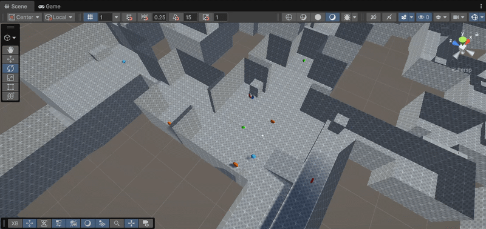
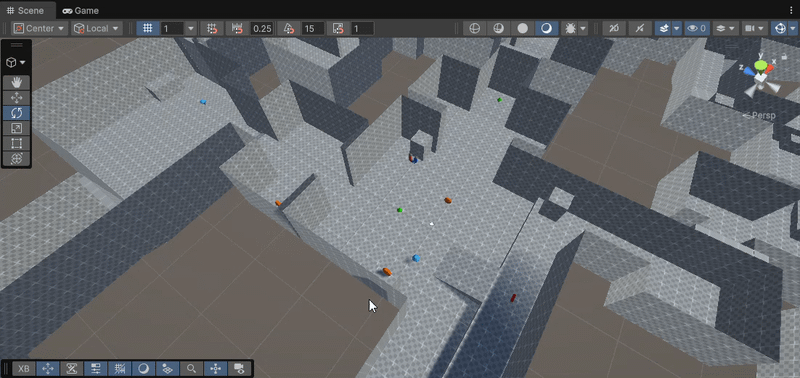

# Practica_5_II
**Asignatura:** Interfaces Inteligentes  
**Universidad:** Universidad de La Laguna (ULL)  
**Autor:** Darío ([@Dario-ULL](https://github.com/Dario-ULL))

---

## Estructura del Repositorio
- **Scripts/**: Contiene los scripts en C# desarrollados para los ejercicios prácticos de control físico e interacciones.
- **Gif/**: Contiene las capturas y animaciones GIF que demuestran el comportamiento de cada situación física y ejercicio.

---

## 1. Descripción del Proyecto
Esta práctica consiste en el desarrollo y despliegue de una experiencia inmersiva de Realidad Virtual móvil utilizando el **Google Cardboard XR Plugin** sobre el motor **Unity 6**. 

La aplicación integra mecánicas de interacción basadas en la mirada (*Gaze Interaction*), un sistema de desplazamiento continuo por inclinación angular de cabeza (*Head-Tilt Locomotion*) y dinámicas de interacción espacial con objetos coleccionables mediante atracción y restauración de coordenadas originales.

---

## 2. Demostración y Ejecución

### Mecánicas de Mirada y Desplazamiento

  

### Mecánicas de Restauración

  

### Mecánicas de Atracción

  

---

## 3. Estructura y Componentes Clave

### A. Inicialización Segura de XR (`CardboardStartup.cs`)
Para prevenir crasheos en tiempo de ejecución debidos a la sincronización de la superficie nativa de Android y el acceso al sensor de cámara, el ciclo de arranque se implementó mediante una corrutina que desacopla la inicialización del primer ciclo de ejecución.

### B. Sistema de Desplazamiento por Inclinación (`HeadTiltWalk.cs`)
Mecánica de movimiento sin mandos físicos:
* **Zona Muerta:** La mirada en rango horizontal mantiene al usuario inmóvil para inspección visual.
* **Umbral de Activación:** Al inclinar la cabeza hacia abajo (> 20°), el jugador avanza de manera constante en la proyección horizontal de su vector de visión (`forward`).
* **Límite de Seguridad:** Si el ángulo supera los 80° (mirada directa al suelo), el avance se desactiva para evitar desplazamientos accidentales.
* **Gravedad y Colisión:** Controlado a través de un `CharacterController` sobre un escenario con colisionadores no convexos (`Mesh Collider`).

### C. Detección por Mirada (`CameraPointer.cs`)
Emisión continua de un `Raycast` desde la cámara principal hacia el centro del campo de visión:
* Notifica eventos `OnPointerEnter` y `OnPointerExit` a los objetos interactuables impactados por la retícula.
* Emula el comportamiento giroscópico en el editor de Unity mediante la captura de deltas del ratón (`Mouse.current`).

### D. Dinámicas de Objetos (`MyObjectController.cs`, `ObjectAttractor.cs`, `ObjectRecovery.cs`)
* **Coleccionables (`MyObjectController`):** Almacenan sus coordenadas y rotaciones espaciales originales al iniciar la escena. Modifican su material al entrar en contacto con la retícula.
* **Objeto Atractor (`ObjectAttractor`):** Al ser enfocado por la mirada, localiza todos los coleccionables activos y los traslada suavemente (`Vector3.MoveTowards`) hacia una posición frontal relativa al jugador.
* **Objeto Restaurador (`ObjectRecovery`):** Al mirarlo, cancela la atracción de los coleccionables y activa una transición suave hacia sus posiciones iniciales de origen.
